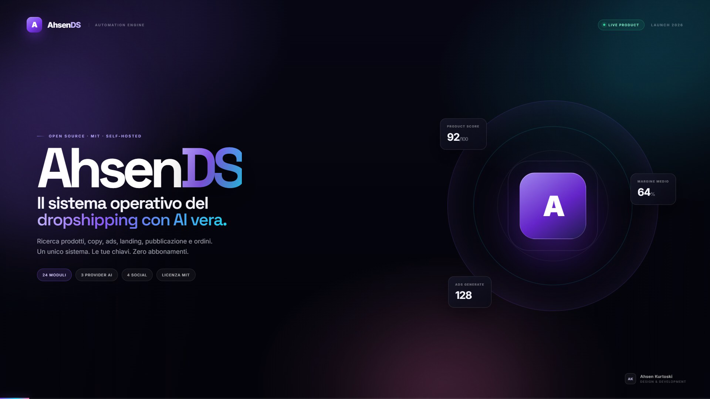

# 🛒 AhsenDS — Costruito da Ahsen Kurtoski

Piattaforma avanzata e autonoma di automazione dropshipping + affiliate marketing — **ideata, progettata e costruita interamente da Ahsen Kurtoski**.
Alternativa moderna, self-hosted e completa a strumenti come AutoDS: include ricerca prodotti reali, radar automatico dei vincenti, generazione di video ads con intelligenza artificiale, web studio per landing page da 10.000€ e pubblicazione automatica su TikTok, Instagram, Facebook e YouTube.

Tecnologie: **Next.js 14 (App Router) + TypeScript + Tailwind CSS + Supabase**, interfaccia ultra-moderna in dark mode con glassmorphism.

> ⚡ **Sviluppato da Ahsen Kurtoski.**
> Usa servizi reali (CJ Dropshipping, Groq/OpenRouter/Gemini, Supabase). Senza chiavi l'interfaccia parte con le sezioni vuote (nessun dato inventato) e le API di generazione rispondono `503` indicando la variabile da impostare.

---

## 👨‍💻 Creatore & Architetto del Software
- **Sviluppatore**: **Ahsen Kurtoski**
- **Ruolo**: Fullstack & AI Systems Architect
- **Software**: AhsenDS (Dropshipping Automation OS)
- **Repository**: [AhsenDS](https://github.com/AhsenKurtoski/axsends.git)

---

## 📊 Project impact & development

| Indicatore | Dato |
|---|---|
| **Tempo di sviluppo** | Circa **4 mesi** |
| **Utilizzo dichiarato** | Numero di utilizzatori non attualmente verificato |
| **Diffusione / notorietà** | Dato di notorietà non misurato |
| **Costo del software** | **€0** — software open source, MIT, senza abbonamento |

### Il problema che risolve

AhsenDS (Ahsen Dropshipping System) nasce per ridurre la frammentazione e il lavoro ripetitivo nel dropshipping e nell'affiliate marketing. Riunisce in un solo ambiente strumenti che spesso vengono gestiti separatamente:

- ricerca e valutazione dei prodotti, per evitare di analizzare manualmente tanti cataloghi e opportunità;
- monitoraggio di prezzi e disponibilità, per individuare cambiamenti e ridurre il rischio di promuovere prodotti non disponibili o non convenienti;
- creazione di descrizioni, testi SEO e contenuti promozionali, senza dover scrivere ogni scheda da zero;
- preparazione di script, storyboard e creatività pubblicitarie con strumenti AI;
- generazione di landing page e siti per presentare i prodotti;
- organizzazione di catalogo, fornitori e ordini, con strumenti di automazione e pubblicazione sui canali social supportati.

### Costi e chiavi API

**AhsenDS non richiede un abbonamento per utilizzare il software.** L'applicazione può essere avviata senza chiavi API; per attivare le funzioni collegate a servizi esterni (AI, database, cataloghi, immagini o social) occorrono le relative credenziali. Sono supportati più provider e alcuni offrono piani gratuiti, soggetti ai rispettivi limiti e condizioni. Eventuali costi dipendono dai servizi esterni scelti e dal loro utilizzo: non sono inclusi né garantiti dal progetto.

---

## ✨ Funzionalità Principali

- 📡 **Radar prodotti vincenti** — Scansione multi-nicchia su richiesta su CJ Dropshipping; il cron giornaliero copre il monitoraggio prezzi/stock.
- 🚀 **Ricerca prodotti con AI Scoring** — Algoritmo proprietario che calcola un punteggio di potenziale da 0 a 100.
- 📈 **Trend virali** — Monitoraggio delle categorie ed elementi ad alta richiesta.
- ⚡ **Catalogo automazioni (47+ voci)** — Stato reale dei servizi richiesti e preferenze salvate in locale.
- 🏷️ **Regole di prezzo dinamiche** — Markup intelligente, margine minimo protetto, arrotondamento psicologico a .99.
- 📝 **Copywriting & Schede Prodotto AI** — Generazione testi SEO persuasivi senza template fissi.
- 🎬 **AI Ads Generator** — Script, storyboard scena per scena, copy ad alta conversione, fotogrammi AI (Hugging Face).
- 🎥 **Pubblicazione Multi-Piattaforma** — Integrazione con API ufficiali di TikTok, YouTube, Instagram e Facebook.
- 🌐 **Web Studio Premium** — Generatore autonomo di landing page e siti web completi da agenzia lusso in un singolo file HTML.
- 🤖 **Autopilot in 1 Clic** — Trova il miglior prodotto, lo salva nel catalogo, scrive l'ad virale e costruisce la landing page.
- 💵 **Affiliate & Centro Guadagni** — Generatore link con disclosure legale e 17 metodi di monetizzazione pronti all'uso.
- 🔔 **Monitoraggio Prezzi & Stock** — Cron automatico per evitare vendite sotto costo o prodotti esauriti.
- 🩺 **Diagnostica completa** — Stato reale di AI, Supabase, CJ e social, con verifica delle sei tabelle e istruzioni di riparazione.
- 🚚 **Gestione Fornitori · 🛍️ Ordini · 📊 Analytics in tempo reale**.

---

## 💸 Gratis e open source

- **Il software è gratuito**: licenza MIT, nessun abbonamento, nessuna funzione bloccata. Puoi usarlo, modificarlo e ridistribuirlo.
- **Nessuna simulazione**: se manca una chiave o un modello non risponde, l'API restituisce un errore esplicito (`503`/`502`) con il nome della variabile da impostare. Non viene generato contenuto finto.
- **Servizi opzionali con piano gratuito**: Groq/OpenRouter/Gemini (testi), Supabase (database e login), CJ Dropshipping (prodotti), Hugging Face (immagini). I limiti restano quelli dei rispettivi provider.
- **Nessun guadagno garantito**: il software automatizza il lavoro, non i risultati.

---

## 🎬 Launch Kit

[](assets/launch/video/ahsends-launch-16x9.mp4)

Film di lancio, teaser verticale, otto schermate reali, poster e press kit completo. La pagina pubblica è **`/launch`**.

**Live:** [App completa su Vercel](https://axsends.vercel.app) · [Launch Kit](https://axsends.vercel.app/launch) · [English presentation](https://axsends.vercel.app/en) · [Mirror statico Cloudflare](https://site-03f75a10e2254b60a2b392f043f61d49.freebuff.page/launch)

**Collaborazioni:** [ahsenkurtoski@financier.com](mailto:ahsenkurtoski@financier.com?subject=Collaborazione%20istituzionale%20%E2%80%94%20AhsenDS) · **WhatsApp Business:** [+39 331 205 3485](https://wa.me/393312053485)

**Modulo contatti:** attivo sulla landing italiana e su `/en`. Le richieste vengono validate, limitate a 5 invii al minuto e salvate in **Supabase > Table Editor > `settings`**, con chiave `contact_request:<uuid>`. Non serve creare una nuova tabella.

**Notifica email:** per ricevere un'email a ogni nuova richiesta, crea una API key SendGrid con permesso **Mail Send** e verifica un **Single Sender** (non serve un dominio custom). Poi imposta in `.env.local` e nelle Environment Variables di Vercel:

```bash
SENDGRID_API_KEY=...
CONTACT_NOTIFY_TO=ahsenkurtoski@financier.com
CONTACT_NOTIFY_FROM=ahsenkurtoski@financier.com
CONTACT_NOTIFY_FROM_NAME=AhsenDS
```

Dopo il redeploy, ogni richiesta invia una notifica con il Reply-To del visitatore. Se la chiave manca o la notifica fallisce, la richiesta resta comunque salvata su Supabase e il form non perde il contatto.

| Asset | Formato | File |
|---|---|---|
| Launch film | MP4 · 1920×1080 · 44 s | [Guarda / scarica](assets/launch/video/ahsends-launch-16x9.mp4) |
| Teaser social | MP4 · 1080×1920 · 18 s | [Scarica](assets/launch/video/ahsends-teaser-9x16.mp4) |
| Poster verticale | PNG · 1080×1920 | [Apri](assets/launch/teaser-vertical-poster.png) |
| Screenshot | PNG · 1920×1080 · 8 file | [Contact sheet](assets/launch/contact-sheet.png) · [Gallery](assets/launch/gallery.html) |
| Copy social | Markdown | [Hook, caption e piano 7 giorni](assets/launch/social-copy.md) |
| Kit pubblicazione teaser | Markdown | [TikTok e Reels, pronto al caricamento](assets/launch/teaser-publish-kit.md) |
| Press kit | ZIP · 26,7 MB | [Scarica tutto](assets/launch/ahsends-launch-kit.zip) |

Tutti gli asset hanno il watermark **AhsenDS · Ahsen Kurtoski**. Musica originale, nessun sample di terzi.

---

## 🚀 Avvio Rapido

Requisiti: **Node.js 18.17+** e npm.

```bash
git clone https://github.com/AhsenKurtoski/axsends.git
cd ahsends
npm install
cp .env.example .env.local   # Windows: copy .env.example .env.local
npm run dev
```

Apri `http://localhost:3000` per la landing pubblica, `http://localhost:3000/launch` per il launch kit (film, teaser 9:16, screenshot e download), `http://localhost:3000/app` per la dashboard.

Se Supabase è configurato l'accesso è obbligatorio: crea il tuo utente in **Supabase > Authentication > Users** e accedi da `/login`.

---

## ☁️ Deploy

Produzione: **[axsends.vercel.app](https://axsends.vercel.app)**. Il progetto Vercel è collegato al branch `main` per il deploy automatico: ogni push su GitHub avvia una nuova build. Il piano Hobby consente un solo cron al giorno, configurato alle 03:00 in `vercel.json`.

Per un deploy manuale dalla root del progetto: `npx vercel --prod`.

---

## 🔄 Come aggiornare il progetto

Dalla cartella del progetto:

```bash
git pull
npm install
npm run dev
```

---

## 🔑 Configurazione Servizi e Chiavi API

Crea un file `.env.local` nella cartella principale prendendo come riferimento `.env.example`. Tutte le chiavi sono opzionali: l'app parte anche senza, e la pagina **Diagnostica** ti dice cosa manca.

I modelli predefiniti sono allineati ai cataloghi attuali — GPT-OSS 120B per Groq, Nemotron Ultra (free) per OpenRouter, Gemini 3.8 Flash per Google — e ogni provider ha una catena di sostituti: se un modello viene ritirato, l'app passa al successivo senza smettere di funzionare.

1. **CJ Dropshipping (gratuito)**:
   - Registrati su [cjdropshipping.com](https://cjdropshipping.com)
   - Vai in **My CJ > Authorization > API** e copia la tua API Key.
   - Inserisci `CJ_EMAIL` e `CJ_API_KEY` in `.env.local`.

2. **Intelligenza Artificiale (testi, script e siti)**:
   - **Groq** (gratis e velocissimo): crea la chiave su [console.groq.com/keys](https://console.groq.com/keys) -> `GROQ_API_KEY`.
   - **Gemini** (Google AI Studio): crea la chiave su [aistudio.google.com](https://aistudio.google.com/app/apikey) -> `GEMINI_API_KEY`.
   - **OpenRouter** (modelli free avanzati): [openrouter.ai/keys](https://openrouter.ai/keys) -> `OPENROUTER_API_KEY`.

3. **Database Supabase**:
   - Crea un progetto su [supabase.com](https://supabase.com).
   - Apri **SQL Editor**, incolla il contenuto di `supabase-schema.sql` e premi **Run**.
   - Inserisci `NEXT_PUBLIC_SUPABASE_URL` e `NEXT_PUBLIC_SUPABASE_ANON_KEY` in `.env.local` (obbligatorie per login, catalogo e ordini).
   - `SUPABASE_SERVICE_ROLE_KEY` e opzionale: serve alle automazioni server-side senza sessione (monitor, autopilot). Con il login, import, ordini e diagnostica funzionano anche senza.
   - Crea almeno un utente in **Authentication > Users** (email + password) per accedere a `/login`.

4. **Fotogrammi & Immagini AI (Hugging Face)**:
   - Token gratuito su [huggingface.co/settings/tokens](https://huggingface.co/settings/tokens) -> `HUGGINGFACE_API_TOKEN`.

---

## 🔌 API Endpoints

| Endpoint | Metodo | Descrizione |
|---|---|---|
| `/api/autopilot` | GET | Autopilot: prodotti, catalogo, pacchetto ad, coda e landing page, con stato di ogni passaggio |
| `/api/radar` | GET | Scansione automatica multi-nicchia con calcolo score |
| `/api/research` | GET | Ricerca prodotti su CJ Dropshipping con punteggio |
| `/api/describe` | POST | Scheda prodotto persuasiva + tag SEO |
| `/api/affiliate` | POST | Contenuti promozionali + disclosure per link affiliati |
| `/api/import` | POST | Importazione prodotti con ricarico automatico (sessione o service role) |
| `/api/orders` | GET / POST | Gestione ordini su database protetto da RLS |
| `/api/suppliers` | GET | Elenco fornitori verificati |
| `/api/fulfill` | POST | Preparazione evasione ordine verso CJ |
| `/api/monitor` | GET | Snapshot periodico prezzi e stock per cron jobs |
| `/api/generate-ad` | POST | Pacchetto ad completo: script, storyboard con testo a schermo, sottotitoli SRT/VTT, 12 hashtag, descrizione, keyword e copertina |
| `/api/generate-video` | POST | Video AI gratuito (Wan 2.2 su Hugging Face ZeroGPU) + fotogrammi di riserva |
| `/api/website` | POST | Generazione sito web e landing page completa |
| `/api/contact` | POST | Modulo contatti pubblico: validazione, honeypot, rate limit 5/min, salvataggio in Supabase (`settings`) e notifica SendGrid se configurata |
| `/api/tiktok` | POST | Pubblicazione video su TikTok |
| `/api/youtube` | POST | Caricamento video Shorts su YouTube |
| `/api/products` | GET | Catalogo prodotti (richiede sessione) |
| `/api/ad-queue` | GET / POST | Coda di pubblicazione delle ads |
| `/api/auto-ads` | GET | Ads TikTok + YouTube generate per i prodotti con potenziale, con sottotitoli pronti |
| `/api/storefront` | POST | Testi completi di una landing page di vendita |
| `/api/digital-product` | POST | Ebook/guida vendibile scritta dall'AI |
| `/api/calendar` | POST | Piano editoriale di 7 giorni |
| `/api/pod` | POST | Idee print-on-demand |
| `/api/ugc` | POST | Script, rate card ed email per proporsi ai brand |
| `/api/instagram` | POST | Pubblicazione Reels/post su Instagram |
| `/api/facebook` | POST | Post e video sulla Pagina Facebook |
| `/api/publish-all` | POST | Stesso video su tutte le piattaforme configurate |
| `/api/ai-status` | GET | Verifica dal vivo del provider AI attivo |
| `/api/health` | GET | Diagnostica in tempo reale di tutte le chiavi e servizi |
| `/api/health/fix` | POST | Verifica delle 6 tabelle dello schema (richiede sessione) |
| `/api/auth/logout` | POST | Chiude la sessione Supabase |

---

## 🔒 Sicurezza

- Con Supabase configurato il middleware protegge pagine e API: senza sessione le pagine rimandano a `/login` e le API rispondono `401` in JSON.
- Le tabelle usano la Row Level Security: leggono e scrivono solo gli utenti autenticati.
- `/api/monitor` è raggiungibile dal cron: accetta solo il `Authorization: Bearer <CRON_SECRET>` oppure una sessione valida. Imposta sempre un `CRON_SECRET` casuale in produzione.
- Le chiavi private restano server-side: nel browser finiscono solo le due variabili `NEXT_PUBLIC_*` di Supabase.
- `POST /api/health/fix` richiede una sessione utente autenticata e usa la service role se presente; altrimenti verifica le tabelle con il client autenticato (RLS).

---

## 💎 Crediti e Licenza

Software ideato, sviluppato e manutenuto da **Ahsen Kurtoski**.

Rilasciato con licenza **MIT** — vedi il file [LICENSE](./LICENSE).

---

## 🔑 Doppie chiavi API (fallback automatico)

Ogni provider di testo accetta **due chiavi**. Se la prima finisce il credito giornaliero, scade o viene rifiutata, la stessa richiesta passa alla seconda senza interruzioni:

| Provider | Chiave primaria | Chiave di riserva |
|---|---|---|
| Groq | `GROQ_API_KEY` | `GROQ_API_KEY_2` |
| Google Gemini | `GEMINI_API_KEY` | `GEMINI_API_KEY_2` |
| OpenRouter (opzionale) | `OPENROUTER_API_KEY` | `OPENROUTER_API_KEY_2` |

Il codice prova modello per modello e chiave per chiave, con timeout di 25 secondi per tentativo, e ricorda la coppia modello+chiave che ha funzionato. Per aggiungere le seconde chiavi apri `.env.local`, incolla i valori e riavvia `npm run dev`. La pagina **Diagnostica** mostra quale chiave e quale modello stanno rispondendo.

## 🎬 Video AI gratuito (senza carta di credito)

La generazione video non usa servizi a pagamento:

1. **Fotogramma** — Pollinations (`image.pollinations.ai`): gratuito, nessuna chiave, nessuna carta.
2. **Animazione** — **Wan 2.2 I2V** su **Hugging Face Spaces con ZeroGPU**: un account gratuito ha 5 minuti di GPU al giorno e non richiede carta. Il fotogramma viene animato in un MP4 verticale di 3 secondi, pronto da scaricare e pubblicare.

Variabili:

```bash
HF_VIDEO_SPACE=prithivmlmods/Wan2.2-Fast   # cambia Space senza toccare il codice; "off" disattiva il video
HUGGINGFACE_API_TOKEN=...                  # opzionale: usa la tua quota GPU invece di quella anonima
```

Se lo Space e in coda o la quota giornaliera e finita, la pagina Ads mostra automaticamente i fotogrammi AI: il flusso di lavoro non si blocca mai.

Altri servizi gratuiti senza carta, se vuoi un video piu lungo: **Google Flow** (5 clip da 8 secondi al giorno dal browser, non ha API) e **Shotstack** (10 crediti gratuiti alla registrazione, con API).

## 🏷️ Ads pronte alla pubblicazione

`POST /api/generate-ad` restituisce un pacchetto completo, non solo lo script:

| Campo | Cosa contiene |
|---|---|
| `hook` + `variants` | Prima frase e 3 alternative per l A/B test |
| `title` | Titolo max 90 caratteri per YouTube Shorts |
| `description` | Descrizione completa (700-1000 caratteri) con gancio, benefici, elenco puntato, CTA e hashtag finali |
| `hashtags` | 12 hashtag virali misti (grandi, di nicchia, specifici del prodotto), gia con il cancelletto |
| `keywords` | 10 keyword senza # per i tag di YouTube |
| `caption` | Caption max 150 caratteri pronta per TikTok e Reels |
| `scenes` | Storyboard di 5 scene con tempi, visual e voiceover |
| `targeting` | Pubblico, interessi e orario consigliato |

Le stesse informazioni vengono usate dai pulsanti di pubblicazione: TikTok e Instagram ricevono caption + hashtag, YouTube riceve titolo, descrizione completa e tag.

---

## 🎬 Video e sottotitoli da studio

La pagina **AI Ads** produce un pacchetto pronto alla pubblicazione, non solo uno script:

- **Storyboard** in 5 scene con tempi, movimento di camera, voiceover e **testo a schermo** di 3-6 parole per scena.
- **Sottotitoli professionali** generati dallo storyboard: massimo 2 righe, righe bilanciate, tempi allineati al voiceover. Scaricabili in **.srt** e **.vtt** e gia pronti per CapCut, Premiere o DaVinci.
- **Anteprima con sottotitoli sincronizzata**: player con la linea temporale vera dell'ad (scene + cue SRT), play/pausa e barra per spostarsi nel tempo. La caption compare esattamente al suo secondo, sullo stile dei reel (bianco, bold, contorno nero), e lo storyboard avanza con un lento Ken Burns: non e una proporzione sul clip di 3 secondi.
- **Video completo con sottotitoli bruciati**: dalla stessa scheda si scarica l'ad intera (720x1280, durata reale dello script, zoom lento per scena, vignettatura e caption disegnate ai tempi esatti del SRT). Formato MP4 H.264, con WebM come riserva se il browser non lo supporta.
- **Video AI** generato con prompt da studio: ottica 35mm, key light + rim light, color grading, dolly-in lento, 9:16.

- **Voiceover TTS gratuito**: la voce legge lo script e parte insieme a ogni sottotitolo (audio mixato sulla timeline, non un sottofondo), con normalizzazione morbida per evitare clipping. Si disattiva dal toggle accanto all'export. Il video dichiara se la voce e davvero nel file, non solo se e stata chiesta.

La voce arriva da un endpoint pubblico di Google Translate (`/api/tts` fa da ponte, nessuna chiave e nessuna carta): e un endpoint non ufficiale, quindi se si ferma la route risponde con il motivo reale e il video viene esportato muto invece di rompersi.

Il formato dei sottotitoli e protetto da controlli automatici: `npm run check:subtitles` compila i moduli veri e verifica che nessuna riga superi i 42 caratteri, che `maxLines` sia rispettato e che il testo dell'SRT coincida riga per riga con quello disegnato nel video. Il test esce con codice diverso da zero appena una regola si rompe, quindi puo essere usato in CI o come pre-commit.

Il clip gratuito dura 3 secondi perche la quota ZeroGPU e di 5 minuti al giorno: per un ad da 20 secondi monta il clip in loop con i fotogrammi e il file SRT (lo stesso flusso di uno studio, con strumenti gratuiti).

Il video riusa l'immagine gia generata per l'ad: una sola generazione per tutto il pacchetto. Le immagini gratuite hanno un limite reale di **1 ogni 45 secondi per IP**, gestito dal codice con una coda che distanzia le richieste; con una pollen key gratuita (`POLLINATIONS_TOKEN`) il limite sparisce.

## 🩺 Diagnostica e stato del progetto

La pagina **Diagnostica** (`/app/settings`) fa un controllo reale, non simulato, di ogni servizio:

- **Punteggio di prontezza** (0-100%) su quello che serve davvero: AI testi, immagini, database.
- **Chiavi per provider**: quante chiavi Groq, Gemini e OpenRouter sono configurate (1 o 2).
- **Tabelle del database**: le 6 tabelle dello schema vengono verificate automaticamente a ogni controllo.
- **Variabili mancanti**: elenco esatto delle env da impostare, con il servizio che le usa.
- Ogni servizio riporta stato (`Funziona`, `Errore`, `Da verificare`, `Mancante`) e il motivo reale, incluso il modello AI e la chiave in uso.

## 🤖 Autopilot

L Autopilot esegue in sequenza e mostra lo stato di ogni passaggio: ricerca CJ, punteggio e margini, salvataggio catalogo, pacchetto ad con sottotitoli, coda di pubblicazione, landing page. Se un passaggio fallisce lo dice con il motivo esatto (credenziali mancanti, tabella assente, AI non raggiungibile) invece di inventare contenuti.
